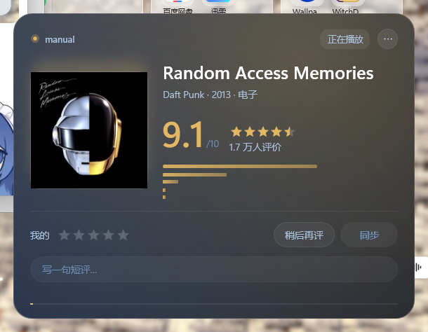
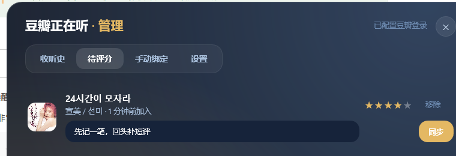
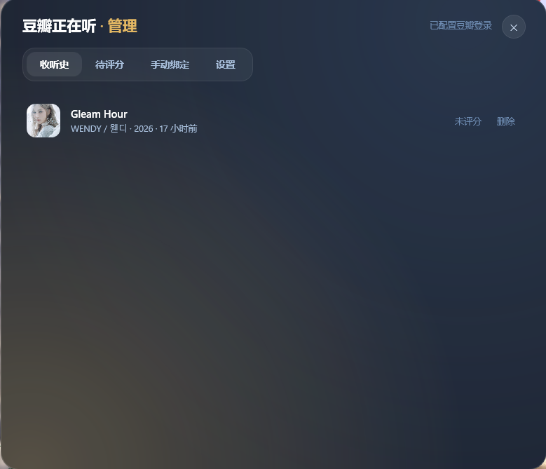

# 豆瓣正在听

一个 Windows 桌面小浮窗：你在 Apple Music 里放专辑，它实时认出来，把这张专辑在**豆瓣音乐**上的评分、人数、星级分布摆到你眼前；你顺手给 1–5 星、写一句短评，点「同步」就写回豆瓣。

<p align="center">
  
</p>

<p align="center">
  
</p>

---

> 第一次用？先看 **[使用教程](使用教程.md)**（也有 [网页版](使用教程.html)），比这里更直白。

## 快速开始

**需要：Node.js 18+**（用来跑本地服务和豆瓣请求）。没装的话去 [nodejs.org](https://nodejs.org/) 装一个 LTS 版本。

> **想直接用**：去 [Releases](https://github.com/shangchuanwu03/douban-nowplaying/releases) 下载 `DoubanNowPlaying-1.5.4-Setup.exe`，双击装完就能用，不用管下面的编译步骤。
>
> **从源码克隆的**：仓库不含编译好的 `douban-overlay.exe`，先跑一次 `npm run build`（需要 Windows 自带的 .NET Framework 4.x），`启动.bat` 才有东西可启动。

1. 双击 **`启动.bat`**
2. 悬浮窗出现在屏幕右下角，后台会自动拉起本地服务（`http://127.0.0.1:4590`）
3. 在 Apple Music 里播放一张专辑
4. 切歌后 2–4 秒，封面和豆瓣评分就会自己补上
5. 想看收听史、换皮肤或配置豆瓣 Cookie：点浮窗右上角的 **⋯**，或双击 **`管理.bat`**（已开着的窗口会被直接唤到前面）

退出：在浮窗上**右键 → 退出**。退出时会一并关掉它自己启动的后台服务。

---

## 它能做什么

| 能力 | 说明 |
| --- | --- |
| 实时识别 | 从 Windows 系统媒体控制（SMTC）读取「正在播放」，不依赖任何播放器插件 |
| 豆瓣评分 | 分数、评价人数、五星分布条，秒级刷新 |
| 我的评分 | 点星星给 1–5 星，短评自动存本地 |
| 写回豆瓣 | 一键把评分 + 短评提交到豆瓣音乐（需要登录 Cookie） |
| 收听史 | 点浮窗上的「⋯」打开应用内窗口，看听过哪些专辑、给过几分 |
| 手动绑定 | 豆瓣匹配错了，在同一个窗口里搜一次并绑定，之后这张专辑就走你的选择 |
| 不误报 | 浏览器看视频、看剧不会触发（按应用 + 标题过滤） |
| 皮肤切换 | 「新拟物」浅色与「玻璃拟态」深色两套，设置里一键换，重启后保持 |
| 账号绑定 | 用默认浏览器登录豆瓣，剪贴板一键导入 Cookie，自动验证并记住昵称 |
| 导入历史 | 把豆瓣上「听过的音乐」拉进本地，已评过的专辑直接显示你的分数，不会误覆盖 |

<p align="center">
  
</p>

### 第二套皮肤：玻璃拟态

<p align="center">
  
</p>

深墨夜景底 + 两团柔光斑、8% 白玻璃面板、香槟金唯一强调色。切换入口在 **⋯ → 设置 → 界面皮肤**：

<p align="center">
  
</p>

**支持的播放器**：任何往系统媒体控制上报信息的播放器 —— Apple Music 桌面版、Spotify、网易云音乐、QQ 音乐、foobar2000、MusicBee、VLC 等都行；在浏览器里放 Apple Music 网页版也能识别。

---

## 绑定豆瓣账号

默认是**只读模式**：能看豆瓣评分、能在本地给自己打分，但不会动你的豆瓣账号。

**流程**：浮窗 **⋯ → 设置 → 豆瓣账号 → 打开豆瓣** → 用你的默认浏览器打开豆瓣官网，登录后复制 Cookie → 回来点 **「从剪贴板读取」**，程序会自动解析 `bid` / `dbcl2`、验证身份，并显示「已绑定：昵称」。

复制方法（约 20 秒）：

1. 登录后按 `F12`，切到 **应用 / Application → Cookie → https://music.douban.com**
2. 选中整段 Cookie 复制（或者只复制 `bid` 和 `dbcl2` 两行也行）
3. 回到设置页点「从剪贴板读取」

也可以直接在文本框里手动粘贴 `bid=xxxx; dbcl2=yyyy`，再点「保存」。

绑定后给专辑打完分，点「同步」，这张专辑就会出现在你的豆瓣「听过」里。想换账号或收回授权，点「解除绑定」即可。

**建议绑定完先导入一次「我听过的」**：程序会把你在豆瓣上已有的星级和短评选进来。导入过的专辑，浮窗上会直接显示你打过的分，按钮变成「已同步」——不会再被误覆盖。

两种方式，都是一次点完：

| 方式 | 操作 | 说明 |
| --- | --- | --- |
| 应用内 | 设置 → 「导入我在豆瓣听过的评分 →」 | 会一直跑到拉完为止，进度显示在按钮右边 |
| 命令行 | 双击 **`导入豆瓣收藏.bat`** | 等价于 `node scripts/import-collection.js`，每批打印进度 |

**先预览再导入**：`node scripts/import-collection.js --dry` 只打印解析结果、不写库，确认没扒错再正式跑。

收藏特别多也不用管，中途关掉下次会从断点继续；拉完会自动归零，再点一次就是完整刷新一遍。

> ⚠️ Cookie 等同于登录凭证，只保存在本机 `data/db.json`，不会上传到任何服务器。写回会以你的名义操作豆瓣账号，请自行判断风险；`dbcl2` 过期（重新登录）后需要重新粘贴。

---

## 匹配不准怎么办

豆瓣上同一张专辑经常有多个版本（首版、再版、磁带、引进版），自动匹配不总是完美。

- **一次修正，永久生效**：右键 → 历史与设置 → 「手动绑定」→ 搜索专辑名 → 点「绑定」。绑定结果按「专辑名 + 艺人」缓存 30 天。
- 想让它重新自动识别：删掉 `data/cache.json` 里对应的条目，或直接删掉这个文件。

---

## 安装包

成品安装包在 **[Releases](https://github.com/shangchuanwu03/douban-nowplaying/releases)** 页发布：下载 `DoubanNowPlaying-1.5.4-Setup.exe`（约 700 KB，单文件，内置全部运行文件）。

> 文件是英文名，因为 GitHub 会把附件名里的中文清成 `-`。它就是本地 `dist\豆瓣正在听-安装包.exe` 同一个包，安装后程序名仍是「豆瓣正在听」。

> 仓库本身不带编译产物 —— `.exe` 已被 [`.gitignore`](.gitignore) 排除。想核对源码与二进制是否对得上，按下面的步骤自己出包。

- 双击运行，可选安装位置（默认 `%LOCALAPPDATA%\Programs\DoubanNowPlaying`）
- 自动创建开始菜单文件夹和桌面快捷方式
- **不含任何个人数据**：首次运行是全新状态，账号、评分、历史都要你自己登录/导入
- 卸载：开始菜单 →「豆瓣正在听 → 卸载」，或在「设置 → 应用」里卸载
- 静默安装：`豆瓣正在听-安装包.exe /S`

重新打包：

```powershell
# 1) 编译浮窗主程序（用 Windows 自带的 csc.exe，无需第三方 SDK）
powershell -NoProfile -ExecutionPolicy Bypass -File overlay\build.ps1

# 2) 打包安装程序：抓运行文件 → 压 payload.zip → 编译单文件 exe
powershell -NoProfile -ExecutionPolicy Bypass -File installer\build-installer.ps1

# 产物：dist\豆瓣正在听-安装包.exe
```

---

## 目录结构

```
<项目根目录>\
├─ 启动.bat / 管理.bat / 导入豆瓣收藏.bat / 检查播放器.bat
├─ douban-overlay.exe        浮窗主程序（编译产物，跑 npm run build 生成）
├─ README.md                 本说明
├─ LICENSE                   GNU GPL v3.0
├─ 使用教程.md / .html        图文教程（网页版双击即看）
├─ docs\                     开发者文档（项目说明 / 方案说明 / CHANGELOG）
├─ overlay\  server\  scripts\  ui\    源码
├─ installer\                安装包工程（运行 build-installer.ps1 出包）
├─ dist\                     安装包产物（不提交）
├─ screenshots\              文档截图
└─ data\                     ⚠️ 你的账号、评分、收听记录（自动生成，不提交）
```

---

## 常见问题

**一直显示「还没有在放歌」**
播放器要真的把信息报给 Windows。Apple Music 桌面版、Spotify 都正常；某些播放器用独占输出（ASIO/WASAPI exclusive）时可能不上报。可以先用 `调试-控制台模式.bat` 看服务有没有收到会话。

**豆瓣搜不到 / 评分是「--」**
豆瓣对高频请求会降级返回空页面。程序会自动退回备用搜索源，并对结果做缓存，所以正常听歌不会触发。如果连续失败，等几分钟再试。

**豆瓣明明有这张专辑，却提示「豆瓣没找到这张」**
最常见的原因是播放器在专辑名后面塞了形态后缀：Apple Music 会把 EP 报成 `I've IVE - EP`，
豆瓣搜索会把 `- EP` 当成检索词，真正的专辑反而不在返回结果里。程序会自动清掉
`- EP / - Single / (Deluxe Edition) / (Remastered)` 这类后缀，并在失败后自动重试。
如果还是找不到，打开 <http://127.0.0.1:4590/api/diagnostics>，能看到最近 20 次识别尝试：
用了哪些查询、各返回几条、以及判定失败的原因（`no_results` / `artist_mismatch` / `title_mismatch`）。

**浮窗显示「本地服务未连接」或设置里「无法读取配置」**
本地 node 服务掉线了。程序会自己把它拉起来（约 3 秒判定、12 秒节流），通常几秒内恢复。如果一直不恢复，看 `data/server.log` 里的最后几行——那里记录了服务端的启动和识别日志。

**提示端口 4590 被占用**
上次的进程没退干净。关掉所有浮窗，或在任务管理器里结束 `node.exe`（命令行含 `douban-nowplaying`）后重开。

**为什么不是 Electron？**
在这台机器上 Electron 一启动就 access violation 崩溃（35 / 45 两个版本、计划任务里也一样），但普通 WinForms/WPF 窗口完全正常。所以浮窗改成了 **.NET Framework 自带的 WPF**：零第三方依赖、包体 53 KB、启动快。

**能换电脑用吗？**
只依赖 .NET Framework 4.x（Windows 10/11 自带）和 Node.js。拷走整个目录即可，`data/` 里是个人数据。

---

## 网页版 / 调试

本地服务本身自带一套网页界面，可以拿来排查问题，也可以直接在浏览器里用：

- 卡片预览：<http://127.0.0.1:4590/>
- 管理页（网页版）：<http://127.0.0.1:4590/manage.html>

应用内已经有同功能的管理窗口，网页版留着方便在别的设备上查看（同一套接口）。

不需要时把浮窗右键退出，服务会跟着关掉。

---

## 隐私

- 所有数据都在本机：`data/db.json`（评分/历史/设置）、`data/cache.json`（豆瓣解析缓存）、`data/covers/`（封面缓存）
- 只访问 `music.douban.com`、`www.douban.com` 和豆瓣图床
- 没有遥测，没有云同步
- 仓库里不含任何账号、Cookie 或评分记录：`data/` 由程序首次运行时自动生成，且已被 `.gitignore` 排除

> 本项目是个人写的第三方工具，与豆瓣官方无关，也不提供任何豆瓣接口。使用「同步」功能等于以你的名义操作豆瓣账号，请自行判断风险；豆瓣侧有频率限制，请勿高频请求。

---

## 许可证

本项目以 **GNU General Public License v3.0** 发布，详见 [LICENSE](LICENSE)。
