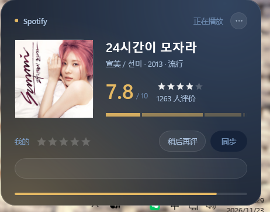
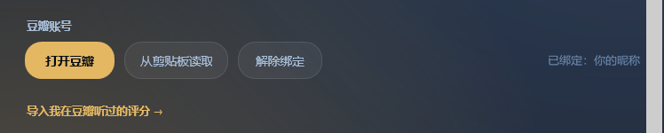
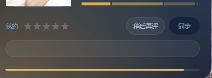
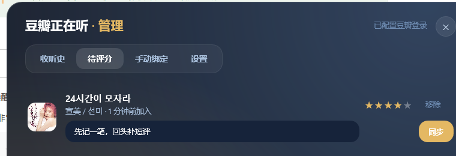
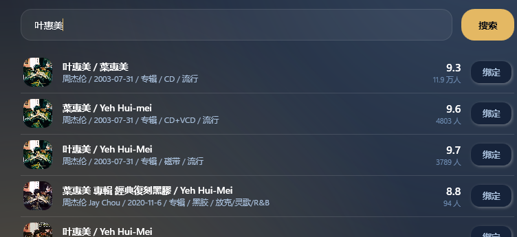

# 使用教程

> 5 分钟看完，就能用起来。

---

## 一、启动

双击 **`启动.bat`**（或桌面快捷方式「豆瓣正在听」）。

浮窗出现在屏幕**右下角**，本地服务会自动在后台跑起来。默认「自动识别」——谁在放歌就认谁（Apple Music / Spotify / 网易云 / QQ 音乐）。

**退出**：在浮窗上右键 → 退出。
**管理**：点浮窗右上角的 **⋯**，或双击 `管理.bat`。

> 小提示：浮窗可以拖着走——按住顶栏或封面拖动即可。Ctrl+滚轮能缩放。

---

## 二、第一次使用：绑定豆瓣（只做一次）

没有豆瓣账号也能看评分，但**要给专辑打分并同步回豆瓣，必须先绑定**。

1. 打开管理窗口 → **设置** 标签 → 点 **「打开豆瓣」**
2. 在浏览器里登录豆瓣（登录过的可以跳过）
3. 按 **F12** → **网络 / Network** 标签 → 刷新页面
4. 点任意一个 `douban.com` 请求 → **标头 / Headers** → 找到 `Cookie`，右键「复制值」
5. 回到设置窗口 → 点 **「从剪贴板读取」**

成功后右上角会显示 **「已绑定：你的昵称」**。

---

## 三、导入你「听过」的评分（建议做一次）

绑定完，点 **设置 → 「导入我在豆瓣听过的评分 →」**。

它会把你豆瓣上已有的星级和短评全部拉进来（约 1700 张，2–3 分钟）。

导入过的专辑，浮窗会直接显示你当年打的分和写的短评，按钮是 **「已同步」**——不会误覆盖。

> 中途关掉也没事，下次会从断点继续。

---

## 四、日常使用

在 Apple Music / Spotify / 网易云 / QQ 音乐里播放一张专辑，浮窗会在 2–4 秒后自动出现豆瓣信息。

**浮窗上每一块是什么：**

| 位置 | 内容 |
| --- | --- |
| 左上角 | 播放器名 · 当前曲目（如 `Spotify · 24시간이 모자라`） |
| 右上角 | 播放状态 + 「⋯」菜单 |
| 封面右侧 | 专辑名、艺人 · 年份 · 流派 |
| 大数字 | 豆瓣评分，右边是豆瓣星级和评价人数 |
| 金色横条 | 评分分布（几星各占多少） |
| 我的 | 你自己打的星 |

**打分**：点「我的」那排星星（1–5 星）
**写评语**：星星下方那行输入框，输入完按回车或用鼠标点别处就保存
**同步**：点 **「同步」**，这张专辑就进了你豆瓣的「听过」

---

## 五、没空打分？用「稍后再评」

点 **「稍后再评」**，这张专辑就进了 **管理 → 待评分**。

以后在待评分里：

- **点星打分** + 写评语
- 点 **「同步」** 写入豆瓣，成功后自动从列表消失
- 不想评了点 **「移除」**

---

## 六、设置里能改什么

打开 **管理 → 设置**：

| 设置项 | 说明 |
| --- | --- |
| **播放器** | 自动 / Apple Music / Spotify / 网易云 / QQ 音乐。选「自动」= 谁在播就认谁；指定后只认这一个 |
| **界面皮肤** | 新拟物（浅色）/ 玻璃拟态（深色） |
| **豆瓣账号** | 打开豆瓣、从剪贴板读取、解除绑定、导入听过的评分 |

---

## 七、豆瓣没找到这张专辑？

浮窗会显示 **「豆瓣没找到这张 · 右键「手动绑定」」**。这时：

1. 右键浮窗 → **历史与设置…**（或点 ⋯ → 历史与设置）
2. 切到 **手动绑定** 标签
3. 输入专辑名搜索 → 在结果里找对的那张 → 点 **绑定**

搜索结果按**评价人数从多到少**排列，下面标着人数（`7.8 万人` / `4624 人`），一般第一个就是你要的。

绑定之后，这张专辑以后都会直接认出来，不用再绑。

---

## 八、常见问题

**Q：浮窗一直显示「等待播放」？**
确认播放器真的在放歌（不是暂停）。再看 **设置 → 播放器** 是不是被限定成了别的播放器。

**Q：网易云 / QQ 音乐没反应？**
双击 **`检查播放器.bat`**，它会列出系统当前检测到的播放器，并直接告诉你「会被识别 ✅」还是「不会 ❌ + 原因」。

**Q：点同步提示「没拿到 ck 令牌」？**
豆瓣登录状态可能失效了，重新做一次**第二步**。

**Q：提示「豆瓣没找到这张」但专辑明明有？**
豆瓣在限流（短时间请求太多）。等 10–30 分钟会自动恢复，不用重启。

**Q：点了 ⋯ 没反应？**
右键浮窗任意位置，效果一样。

**Q：同步到豆瓣后落在「在听」而不是「听过」？**
旧版本的问题，现在已修。如果还有，把豆瓣账号重新绑定一次。

---

## 九、几个快捷操作

| 操作 | 效果 |
| --- | --- |
| 顶栏 / 封面拖动 | 移动浮窗 |
| Ctrl + 滚轮 | 放大 / 缩小浮窗 |
| 右键浮窗 | 打开菜单（历史与设置 / 待评分 / 写评分 / 置顶 / 缩放 / 退出） |
| 管理窗口按 Esc | 关闭 |
| `--settings` 启动参数 | 直接打开管理窗口 |

---

需要更详细的技术说明，看 `README.md` 和 `docs/项目说明.md`。
